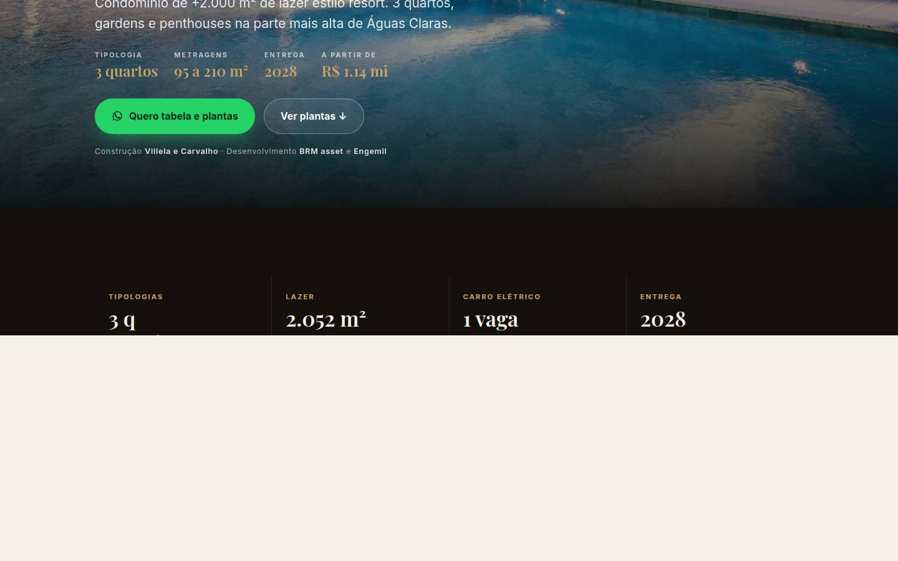
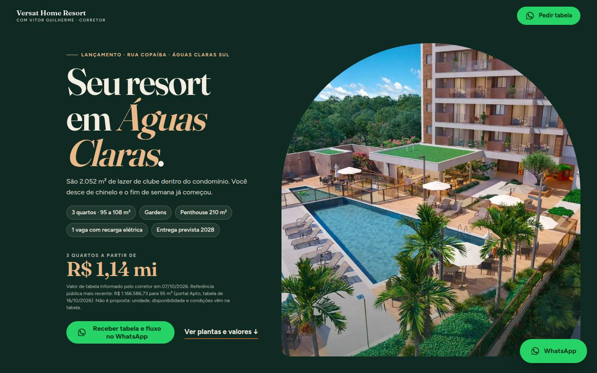
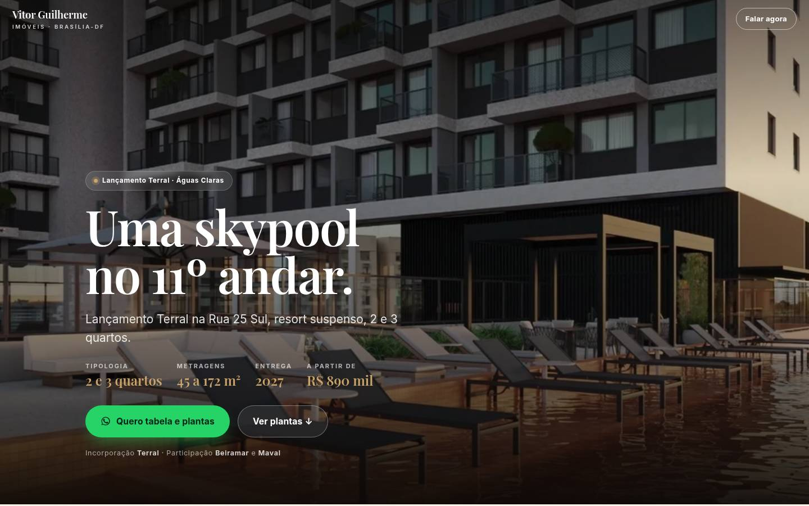
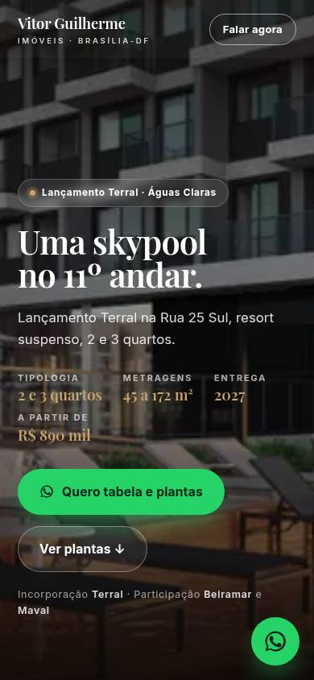

# Reconstrução das LPs Versat e Eleva 25: relatório (20/10/2026)

**No ar e verificadas em navegador real em 20/10/2026, 16h10 UTC:**
- https://vitorguilhermeimoveis.com.br/versat/
- https://vitorguilhermeimoveis.com.br/eleva-25/

## Por que o cliente viu "a mesma coisa"

1. **A entrega anterior nunca foi publicada.** O site é servido pela hospedagem Hostinger (`public_html` da conta `u630398133`), e a versão no ar tinha `last-modified` de **12/10/2026**. O commit de 20/10 (5b13615) ficou só na VPS. O repositório local não tinha `origin`; o `main` do GitHub (81e540f) era a versão de 12/10.
2. **As fotos erradas eram reais:** as fotos apresentadas como "decorado do Eleva 25" eram do **decorado do Versat** (detalhes em `auditoria-imagens.md`).
3. A estrutura de 11 seções continuava a mesma de antes.

## 1. Padrões do benchmarking e onde foram aplicados

Fonte: `benchmarking.md` (45 páginas abertas em Chrome, 37 com conteúdo; screenshots em `benchmarking/shots/`).

| # | Padrão | Aplicado? | Onde |
|---|---|---|---|
| 1 | O botão diz o que a pessoa ganha (a tabela, com o fluxo) | Sim | CTA do hero, barra fixa e topo: "Receber tabela e fluxo no WhatsApp"; cartões: "Quero a tabela do 71 m²"; formulário: "Quero a tabela com o fluxo" |
| 2 | Corretor mostra preço; vitrine esconde | Sim | "a partir de" no hero com fonte e data; valor por planta nos cartões |
| 3 | Primeira dobra: foto grande, nome, 1 linha, chips de metragem, 1 botão | Sim | hero novo nas duas (preço e botão na primeira dobra também no celular) |
| 4 | WhatsApp sempre à mão; no celular, barra larga fixa com a contrapartida | Sim | `.mbar` no celular (some enquanto o botão do hero está visível) e botão flutuante no desktop |
| 5 | Formulário curto (2 a 3 campos), trocando dado por material, sem modal | Sim | 2 capturas, 3 campos (nome, WhatsApp, planta/horário), sem e-mail, sem modal |
| 6 | Escassez concreta, amarrada à tabela | **Parcial** | só "unidades livres por andar" e "tabela muda com o tempo". **Não** foi escrito "últimas unidades": não há dado de estoque (pendência) |
| 7 | Fechar com dúvidas de quem compra na planta + corretor com CRECI | Sim | bloco "Antes de pedir a tabela" + cartão do Vitor; CRECI como placeholder amarelo |
| — | Vídeo no topo | **Não**, de propósito | B-fortes não usam; e o único vídeo disponível de cada produto tem 360×640 e marca de outro anunciante |

Estrutura: **7 dobras** (antes 11). Versat: hero → plantas e valores → captura 1 → decorado e lazer → localização → dúvidas + corretor → captura 2. Eleva: hero (+ faixa de 4 números de localização) → plantas e valores → **localização** (sobe, é o argumento principal) → captura 1 → prédio e lazer → dúvidas + corretor → captura 2.

## 2. Antes e depois

| | Versat antes (no ar até hoje) | Versat depois | Eleva antes | Eleva depois |
|---|---|---|---|---|
| H1 | "Morar num resort, a minutos do Plano Piloto." | "Seu resort em Águas Claras." | "Uma skypool no 11º andar." | "Ao lado do metrô. Na Rua 25 Sul." |
| Seções | 11 | 7 | 10 | 7 (+ faixa) |
| Altura desktop (1440 px) | 10.498 px | **6.805 px** | 9.618 px | **6.213 px** |
| Altura celular (390 px) | 13.963 px | **8.876 px** | 12.820 px | **8.560 px** |
| Imagens (peso total) | 15 JPG, 4,4 MB | 18 WebP, 0,8 MB no celular / 2,4 MB no desktop | 16 JPG, 5,3 MB | 14 WebP, 0,6 MB no celular / 2,2 MB no desktop |
| Fotos erradas | g6 (taças), g7 (selfie do Vitor) na galeria do produto | nenhuma | **decorado do Versat como se fosse do Eleva**, d7 sem origem | nenhuma |
| Modal antes do WhatsApp | sim (versão no ar) | não | sim | não |

Screenshots (em `relatorio/shots/`, capturados das URLs públicas):

| | Desktop, 1ª dobra | Celular, 1ª dobra | Página inteira (desktop / celular) |
|---|---|---|---|
| Versat antes |  |  | [desktop](shots/antes-versat-desktop-full.jpg) · [celular](shots/antes-versat-mobile-full.jpg) |
| Versat depois |  |  | [desktop](shots/depois-versat-desktop-full.jpg) · [celular](shots/depois-versat-mobile-full.jpg) |
| Eleva antes |  |  | [desktop](shots/antes-eleva-desktop-full.jpg) · [celular](shots/antes-eleva-mobile-full.jpg) |
| Eleva depois |  |  | [desktop](shots/depois-eleva-desktop-full.jpg) · [celular](shots/depois-eleva-mobile-full.jpg) |

### Verificação ao vivo (20/10/2026, Chrome headless real, desktop 1440 e iPhone 390)

- HTML servido é o novo: `curl` na URL pública sem parâmetro devolve "desce de chinelo" (Versat) e "Ao lado do metrô. <em>Na Rua 25 Sul" (Eleva); `last-modified` 20/10/2026 16:07 GMT.
- 11 links de WhatsApp por página, **todos** `https://wa.me/556191223005?text=...`; nenhum modal; sem rolagem horizontal (390 e 1440).
- Todo botão visível clicado gerou `wa_click` no `clicks.jsonl` do logger com seção (`topo`, `hero`, `plantas`, `localizacao`, `corretor`, `barra-fixa`, `flutuante`), UTM e gclid/fbclid; o formulário gerou `lead` com `section=captura-1` (testes marcados `is_test`, fora do relatório).
- Único erro de rede: 403 na **primeira** resposta, que é o desafio anti-robô da Hostinger ("Checking your browser"); a página carrega em seguida.

## 3. Imagens trocadas e de onde veio cada nova

Detalhe arquivo por arquivo em `auditoria-imagens.md`. Resumo:

- **Versat (26 arquivos em `versat/img/v3/`)**: 7 fotos do decorado do Versat que estavam na pasta do Eleva (`eleva-25/img/d0`–`d6`), 1 quadro de vídeo do decorado do Versat (`versat/img/hero.jpg`), 8 perspectivas já no repo conferidas com o hotsite oficial, 10 perspectivas baixadas de `versathomeresort.com.br/wp-content/uploads/2026/01/`.
- **Eleva 25 (20 arquivos em `eleva-25/img/v3/`)**: todas perspectivas oficiais da Terral, `terral.inforcedata.com.br/image/11242`–`11285` (página `terralincorporadora.com.br/lancamento/eleva25/71`).
- **Removidas das páginas:** `versat/img/g6.jpg` (detalhe de taças), `versat/img/g7.jpg` (selfie do Vitor na galeria), `eleva-25/img/d0`–`d7` (decorado do Versat / sem origem), quadros de vídeo em faixa 1920×760 do Eleva.
- **Não usadas:** fotos de banco do hotsite do Versat (`familia.webp`, `mulher.webp`) e os 80+ prints da Ad Library do Drive.
- OG novos: `versat/og-v3.jpg` (complexo aquático), `eleva-25/og-v3.jpg` (skypool).

## 4. O que depende do Vitor

Nada abaixo foi inventado; as páginas dizem que a tabela traz esses itens.

1. **Nome completo e nº do CRECI-DF** (rodapé e cartão; hoje campos amarelos `data-pendente`). Obrigatório em anúncio imobiliário: trocar antes de subir tráfego.
2. **Tabela comercial de cada empreendimento:** sinal e quanto de FGTS entra; número e valor das mensais; número e valor das semestrais; saldo nas chaves; índice de correção; tabela por unidade/andar e **validade**.
3. **Data contratual de entrega** (Eleva: 05/2027 × 10/2028 nas fontes; Versat: dez/2028 só em portal).
4. **Vagas por tipologia** (Versat 108 m²: 1 ou 2), suíte × semi-suítes no Versat.
5. **A que unidade corresponde o "a partir de R$ 709.796"** da Terral (e se os 2 quartos de ~45 m² existem e estão disponíveis).
6. Confirmar o **"a partir de R$ 1,14 mi"** do Versat (é o valor que ele passou em 07/10; o portal Apto mostra R$ 1.166.586,73 em 16/10). Se mudou, trocar no hero e no cartão do 95 m².
7. **Estoque real** (para poder usar escassez concreta, padrão 6).
8. **Fotos do decorado do Eleva 25** (não há nenhuma legítima em boa resolução) e um **vídeo curto do Vitor** no decorado de cada produto.
9. **Plantas técnicas** por tipologia e **autorização** de Terral e Villela e Carvalho para uso das imagens.
10. Endereço, dias e horário dos decorados; confirmar o WhatsApp (61) 91223-0005.

## Notas técnicas

- **Publicação:** upload por arquivo via API da Hostinger (`/api/hosting/v1/files/upload-urls` + TUS com `override=true`), só nos caminhos das duas LPs e de `assets/`. Nada mais do site foi sobrescrito. Ficou na raiz um arquivo vazio `_deploy-test.txt` do teste de upload (a API não tem exclusão; inofensivo).
- **Git:** `origin` configurado (`github.com/oguidomingos/vitor-guilherme-lps`), histórico do `main` remoto unido ao local; `master` enviado para `main`.
- **Como editar:** mudar `src/versat.html` ou `src/eleva-25.html` e rodar `python3 scripts/build_lps.py` (preenche `srcset`, `width` e `height` das imagens). As outras LPs do site não foram tocadas.
- Logger de leads `vg-lead-logger` (pm2) online; relatório de cliques: `python3 scripts/relatorio_vitor.py`.
- A auto-resposta do logger ainda cita preços antigos (pendência do README, não alterada: é mensagem enviada em nome do Vitor).
